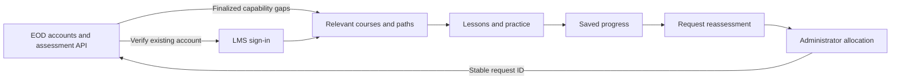

# Assessment and learning architecture

This is a candidate-first, self-paced development journey. Each repository has its own application and database.

| Capability                                                 | Authority                                                         |
| ---------------------------------------------------------- | ----------------------------------------------------------------- |
| Accounts, passwords, MFA, candidate profiles               | EOD-simple                                                        |
| Formal exams, scoring and finalized capability reports     | EOD-simple                                                        |
| Courses, lessons, practice quizzes and explanations        | Anthroprime-LMS                                                   |
| Learning paths, assignments, progress and practice results | Anthroprime-LMS                                                   |
| Reassessment                                               | LMS request and approval workflow; EOD allocates the formal paper |

## Shared identity

LMS verifies the existing username/email, password and optional authenticator/backup code against EOD's `/auth/login`. It does not create another credential store or save passwords. The EOD bearer token is encrypted with AES-256-GCM into an HttpOnly cookie, never returned in browser JSON or stored in localStorage. Production cookies use Secure and the `__Host-` prefix. The LMS cookie lasts eight hours; EOD also enforces its session lifetime.

Every protected LMS request resolves EOD `/auth/me`. Account deactivation or session revocation stops LMS access. If EOD is unavailable, protected calls fail with an actionable error; saved learning data is preserved. This release supports candidate and administrator accounts. Other EOD roles have not been granted authoring permissions implicitly.

This implements shared credentials and central account validation. It does **not** transfer an existing browser session automatically between origins. Opening the other application may require signing in again with the same account. OIDC authorization-code/PKCE is the planned path to seamless cross-application SSO.

Learning identity derives from the configured EOD API instance and immutable candidate ID, never email or name. The database refuses an accidental change to a different EOD instance. EOD account deletion revokes access but does not automatically purge LMS history; coordinated deletion requires an explicit retention policy before production use with personal data.

The integration uses a fixed server-configured EOD origin, without an arbitrary browser-controlled proxy or shared database. Course metadata maps to EOD role/competency IDs. Admin competency reads are projected to identifiers and names; formal question keys do not reach learners.

## Learning behavior

Courses contain ordered modules and lessons: plain-text articles, HTTPS video/resource links, and practice quizzes. Quizzes support 1–10 single-answer questions, 2–6 options, explanations, retries and a configurable pass mark. They never modify formal EOD scores.

Publication validates content, keys, identifiers, durations and track membership. Author updates require the expected version token. Enrollments freeze course content, and path enrollments freeze course order. Later edits or archival cannot change assigned content. Archival stops new enrollment and preserves existing access.

The server grades practice; learner responses omit the key and explanation before submission. A failed attempt does not complete the lesson. A passing attempt advances progress, and a later failed retry cannot erase completion. Reading/resource completion is learner-declared, not evidence of time spent or a proctored examination.

Starting a path atomically creates or reuses its course enrollments. Existing progress is reused. Course order guides the path; prerequisites are enforced between lessons inside each course. The library uses the candidate's finalized tracks for recommendations. Administrators can explicitly assign other published learning.

## Persistence and reassessment

The initial deployment model is **one persistent Node 24 service with SQLite on a durable volume**. WAL, unique enrollment indexes and `BEGIN IMMEDIATE` transactions protect assignments, progress, practice results and audit writes. Audit failure rolls back the local business change. The database is outside the public directory.

Do not deploy the database on an ephemeral function filesystem or run replicas with independent writable copies. A managed PostgreSQL adapter and migrations should precede that model. No production infrastructure has been provisioned.

Network calls occur outside transactions. Reassessment persists a deterministic EOD creation request before sending it. A retry after a lost response uses the same candidate, track, assessor, count and request ID, allowing EOD's existing idempotency contract to return the same paper. Local allocation markers and audit events then commit together. EOD's existing cross-instance allocation limitations still apply.

Audit events have no silent rotation. Database/media backups, retention and restoration require operational policies and testing.

## Security and operational boundary

- Server-enforced role and ownership checks; live central session validation.
- Authenticated encryption of HttpOnly session cookies; persistent key required in production.
- Same-origin mutation checks, a custom request header, and no permissive CORS.
- Fixed upstream URL, HTTPS outside loopback, no redirects or embedded credentials.
- JSON limits, sign-in throttling, bounded inputs and network deadlines.
- Content Security Policy limiting application scripts/styles to the LMS origin.
- Escaped values and plain-text lesson rendering.

The login throttle is process-local and uses the socket address. A production reverse proxy must enforce client-aware edge throttling; forwarded headers are not blindly trusted. This release is not load-certified. The Docker configuration is supplied but has not been built or deployed during local verification.

## Planned increments

1. Managed media uploads, video captions, downloadable files and content accessibility checks.
2. OIDC SSO, delegated author/trainer roles and coordinated EOD/LMS deletion.
3. Rich content, question pools, optional practice rules and enrollment-version migration controls.
4. Due dates, reminders, certificates with explicit criteria and outcome comparisons.
5. Managed database hosting, shared throttling, monitoring and exercised backup restoration.

These capabilities are planned and are not represented by finished-looking controls.
